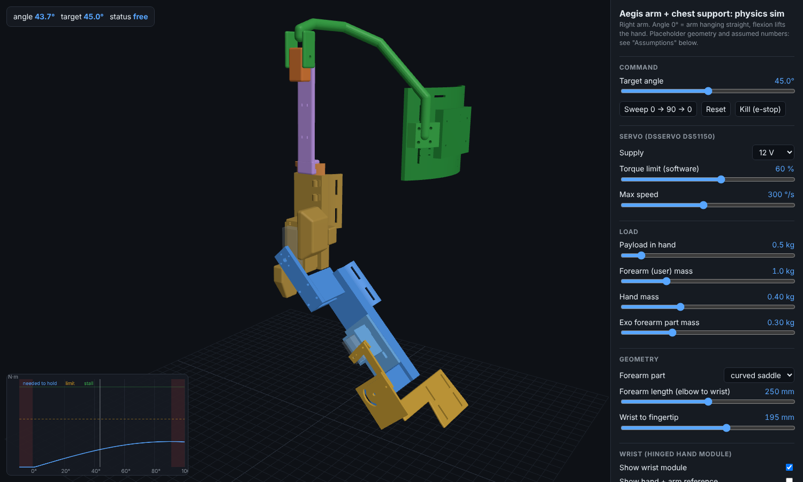
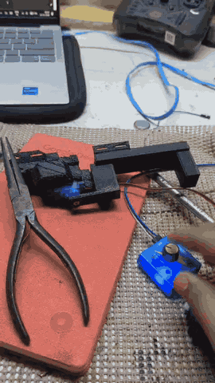

# Aegis Armor (Black Carapace + Aegis)

Hack Club **Fallen** submission by Adhrit Pradeep (Hack Club: adhrit2012).

## Bill of materials

Full file: [`bom.csv`](bom.csv). Prices are shown in US dollars and in Indian rupees (INR), as listed on 16 Nov 2026; the dollar figures are converted at about 95 INR per USD (only a few were read from the live product page, so re-check before buying); "est." means an estimate, not looked up. Notes and old sources are in [`docs/bom-notes.md`](docs/bom-notes.md).

<!-- BOM:START -->
| Item | Qty | USD each | INR each | Store | Status | Link |
|---|---:|---:|---:|---|---|---|
| DS51150 servo, 12 V, 180 deg, single shaft | 1 | 73.67 | 6,999 | Probots | in stock 16 Nov | [link](https://probots.co.in/ds51150-150kg-180-degrees-high-torque-servo-ip65.html) |
| Seeed XIAO ESP32-S3 | 1 | 0 | 0 | owned | owned | [link](https://www.seeedstudio.com/XIAO-ESP32S3-p-5627.html) |
| Muscle BioAmp Candy board | 4 | 8.41 | 799 | Upside Down Labs | in stock 16 Nov (21 listed); not at Robocraze | [link](https://store.upsidedownlabs.tech/product/muscle-bioamp-candy/) |
| Steel thread 316L 2-ply 23 m | 2 | 11.17 | 1,060.82 | ThingBits | in stock 14 Nov | [link](https://thingbits.in/products/stainless-conductive-thread) |
| Fabric paint (Fevicryl) + fusing/iron-on interfacing + plain thread | 1 | 3.16 | 300 | Amazon.in / local tailoring shop | est.; Fevicryl 10 ml listed $0.77; fusing and thread bought locally | [link](https://www.amazon.in/Fabric-Colour-Pack-10ml-Colours/dp/B07Z1X5ZT2) |
| Snap studs, salvaged ECG studs x12 | 12 | 0 | 0 | owned | owned | owned |
| Tight swim shirt / rash guard (Olaian UV 100, long sleeve) | 1 | 10.52 | 999 | Decathlon | price read from page 16 Nov; try on in store | [link](https://www.decathlon.in/p/8611954/men-surfing-uv-rash-guard-100-long-sleeved-grey) |
| Tight stretchy arm sleeve (Kiprun UV) | 1 | 3.15 | 299 | Decathlon | price read from page 16 Nov | [link](https://www.decathlon.in/p/8600763/uv-protected-arm-and-hand-sleeves-running-black) |
| 3S LiPo 11.1 V 2200 mAh 35C, XT60 | 1 | 22.52 | 2,139 | Robocraze | page price $22.52 on 16 Nov; stock listings conflict, recheck; Robodo lists it at $17.18 | [link](https://robocraze.com/products/bonka-2200mah-35c-3s1p-11-1v-lipo-battery) |
| LiPo balance charger iMax B6AC 80W | 1 | 24.75 | 2,351 | Robocraze | in stock 16 Nov | [link](https://robocraze.com/products/imax-b6ac-smart-balance-charger-80w) |
| LiPo charging bag 215x45x165 mm | 1 | 5.04 | 479 | Robu | listed 16 Nov 2026, not re-checked; price may change | [link](https://robu.in/product/lithium-battery-explosion-proof-bag-protection-3/) |
| Buck LM2596 12 V to 5 V, 3 A | 1 | 0.65 | 62 | Robocraze | in stock 16 Nov | [link](https://robocraze.com/products/lm2596-dc-dc-buck-module) |
| Schottky diode 1N5819 (DO-41) | 1 | 0.07 | 7 | Robu | in stock (seen on listing) | [link](https://robu.in/product/1n5819-mdd-40v-600mv1a-1a-do-41-schottky-diodes-rohs/) |
| INA260 current/voltage sensor, 15 A, I2C | 1 | 6.52 | 619 | Robocraze | in stock 16 Nov (1 left) | [link](https://robocraze.com/products/ina260-voltage-current-power-sensor-breakout-with-i2c-interface-7semi) |
| TVS diode P6KE15A (P6KE18A gives more headroom on a full 12.6 V pack) | 1 | 0.90 | 85.05 | element14 India | listed 16 Nov 2026, not re-checked; price may change | [link](https://in.element14.com/multicomp/p6ke15a/diode-tvs-15v-600w/dp/1578809) |
| Capacitor 1000 uF 25 V | 1 | 0.09 | 9 | Robocraze | in stock 16 Nov | [link](https://robocraze.com/products/1000uf-25v-electrolytic-capacitor-through-hole-dip) |
| Relay 12 V 30 A T90 | 1 | 0.73 | 69 | Robocraze | in stock 16 Nov | [link](https://robocraze.com/products/12v-30a-t90-relay) |
| Flyback diode 1N4007 (pack of 10) | 1 | 0.16 | 15 | Robocraze | in stock 16 Nov | [link](https://robocraze.com/products/1n4007-diode-pack-of-10) |
| E-stop 22 mm, 2-pole, twist-release (ProMax) | 1 | 9.46 | 899 | Probots | in stock, pickup in Bangalore 16 Nov; confirm 2 NC on the switch body | [link](https://probots.co.in/promax-22mm-emergency-stop-switch-mushroom-head-waterproof-metal-2-pole.html) |
| Mini blade fuse 10 A + inline holder (5 fuses + holder kit) | 1 | 2.52 | 239.20 | Flipkart / Amazon.in | listed 16 Nov 2026, not re-checked; price may change; takes mini blades | [link](https://www.flipkart.com/pbros-5-pieces-10-amp-mini-blade-fuse-1-pcs-inline-holder-waterproof-line-electrical/p/itmeb1bac62dd289) |
| XT60 connector pair | 2 | 0.31 | 29 | Robocraze | in stock 16 Nov | [link](https://robocraze.com/products/xt60-connector-pair) |
| Silicone wire 14 AWG, 1 m red + 1 m black | 1 | 1.28 | 122 | Robu | Robu per-metre prices ($0.69 + $0.59); stock not checked | [link](https://robu.in/product/high-quality-ultra-flexible-14awg-silicone-wire-red/) |
| Silicone wire 22 AWG, 5 m | 1 | 0.95 | 90 | Robu | Robu per-metre price ($0.19/m); stock not checked | [link](https://robu.in/product-category/batteries/wires-and-cables/silicone-wires/18-to-22-awg/) |
| Velcro strap 25 mm (Bonzella, 5 m) | 1 | 3.15 | 299 | Amazon.in | listed 16 Nov 2026, not re-checked; price may change | [link](https://www.amazon.in/Bonzella-Adjustable-Organizer-Reusable-Securing/dp/B0FQWHWMJW) |
| Nylon zip ties 200 mm (pack of 100) | 1 | 0.76 | 72 | Robu | listed 16 Nov 2026, not re-checked; price may change | [link](https://robu.in/product/nylon-cable-zip-ties-200-mm-white-100pcs/) |
| M4x6 brass heat-set inserts (25) | 1 | 1.19 | 113 | Robu | listed 16 Nov 2026, not re-checked; price may change | [link](https://robu.in/product/m4-x-6-mm-brass-heat-set-threaded-round-insert-nut-25-pcs/) |
| M4 steel socket screws, assorted | 1 | 1.05 | 100 | Robu (EasyMech SS304 M4x16, 25 pcs; price not captured) | est.; price not looked up | [link](https://oldwp.robu.in/product/easymech-ss304-m4-x-16-mm-socket-head-cap-allen-bolt-25-pcs/) |
| M5 bolt set 20 mm (20) | 1 | 0.76 | 72 | Robu | listed 16 Nov 2026, not re-checked; price may change | [link](https://robu.in/product/easymech-m5-x-20mm-chhd-bolt-nut-and-washer-set-20pcs/) |
| M5 nyloc nuts (25) | 1 | 0.37 | 35 | fastdep.in | listed 16 Nov 2026, not re-checked; price may change | [link](https://www.fastdep.in/product/nyloc-nut-m5/) |
| PETG filament | 1 | 0 | 0 | owned | owned | owned |
| **TOTAL (all rows)** | | **230.02** | **21,848.89** | | of which est. 4; all prices in USD at about 95 INR per USD | |
<!-- BOM:END -->

> **Note:** `test-files/` contains the older v12 set, retained for CircuitBench testing. The current part models and their exports are in `cad/`.

A wearable system for the right arm: an **EMG sleeve** ("Black Carapace": steel-thread electrodes on a tight full-sleeved shirt, read by Upside Down Labs Muscle BioAmp Candy boards) driving a **servo elbow exoskeleton** ("Aegis": DS51150 servo at the elbow, optional wrist joint, chest support). Related to the Volition / NPG Lite project.

> **Status: design stage. Nothing is built, bought or tested yet; the BOM is the shopping list for when parts are funded. The firmware in `firmware/` was written for an earlier generic board with an INA219 sensor and has not been ported to the planned XIAO ESP32-S3 and INA260.**

I've been passionate about brain-computer and body-computer interfaces for a long time, and I'm a (secretive) fan of Warhammer 40k, especially its tech. The Black Carapace, the interface space marines use to control their power armor, is the thing I've most wanted to build my own version of. It's a project I kept putting off, and Fallen gave me the push to start. This is my version: a tight full-sleeved shirt with steel-thread electrodes that reads my muscle signals (Black Carapace), driving a servo elbow exoskeleton for my right arm (Aegis).

## What it is and how to use it

- **Black Carapace** is a tight full-sleeved shirt with steel-thread electrodes. Muscle BioAmp Candy boards turn the muscle signal into a voltage the controller can read.
- **Aegis** is a one-arm servo exoskeleton: a DSSERVO DS51150 at the elbow (no wrist servo: it adds weight for little benefit), Velcro straps instead of rigid cuffs, mechanical end stops, and a chest support that links the arm to a chest plate.
- **To look at it:** open the interactive simulator (enable GitHub Pages, then visit `/sim/`). Drag the target angle, load the arm, change the supply voltage and torque limit, show or hide the wrist and the chest support, and press *Kill (e-stop)*.
- **Garment status:** the garment is not built yet. The plan (4 Candy boards on the chest plate, steel-thread electrode traces running through a tight shirt to the chest, tested on both a sleeve and a full shirt, with the noise to be characterised on the bench) is in `docs/garment.md`.
- **To read the parts:** `cad/` holds the 3D files (`cad/freecad/` editable source, `cad/stl/` STL files, `cad/old_steps/` older STEP files), `docs/wiring.md` the wiring.

## Screenshots

### Full 3D assembly
Arm, chest support, an older wrist module (not part of the current build), and a simplified torso model.

The torso is included to provide visual context for the exoskeleton's position relative to the wearer's upper body. It helps illustrate the placement of the chest plate and support structure. It is a visual model, not a printable component or structural part of the exoskeleton.

### PCB
No custom PCB in this build: the electronics are Upside Down Labs boards (Muscle BioAmp Candy x4) and a Seeed XIAO ESP32-S3 controller.

### Schematic / wiring diagram
Created in CircuitBench as a conceptual wiring diagram. Where the exact hardware is unavailable in the component library, generic components are used to represent the corresponding electrical functions. The substitutions and their limitations are explained in `docs/wiring.md`.

### 3D render (optional)
Parts only, then the elbow at 90 degrees (AI MADE FOR REVIEWER'S PLEASURE :) ):

### Anything else
- Live simulator: `/sim/` (GitHub Pages)
- Wiring project file for CircuitBench: `docs/circuitbench/aegis-wiring.circuitbench.json`

## For the build submission

- Hardware demo (SG90 desk version of the elbow, 5 s): [`docs/media/sg90-desk-demo.mp4`](docs/media/sg90-desk-demo.mp4)

  

  What it shows: the printed elbow replica (0.4x mini test parts) being swung by an SG90 servo, driven from a small servo tester. What it is not: the full-size DS51150 arm, and nothing is worn or powered on a person. The EMG garment is not in this clip.

## Repository layout

| Folder | What goes there |
|---|---|
| `firmware/` | Draft servo controller (current limit, kill switch). Not yet ported to the XIAO ESP32-S3 / INA260 hardware. |
| `docs/` | Design notes, safety notes, measurements. |
| `cad/freecad/` | **Editable FreeCAD source** (`.FCStd`) for every part, plus proper STEP exports in `cad/freecad/step/`. See `cad/freecad/README.md`. |
| `cad/stl/` | STL files of the individual parts, plus assembly preview meshes. |
| `cad/old_steps/` | Older STEP files converted from the STL meshes (not editable by dimension). |
| `sim/` | Interactive physics simulation of the elbow, with torso and limb visuals providing body-position context around the mechanism. |
| `test-files/` | Placeholder STLs used only for testing in CircuitBench. see the note above. |
| `bom.csv` | Bill of materials (provisional, see `docs/bom-notes.md`). |

## Safety

This device puts motor torque on a human arm. Required before any real use: a hardware kill switch (e-stop), physical end stops on every joint, a software torque limit and a current limit. See `docs/safety.md`.
