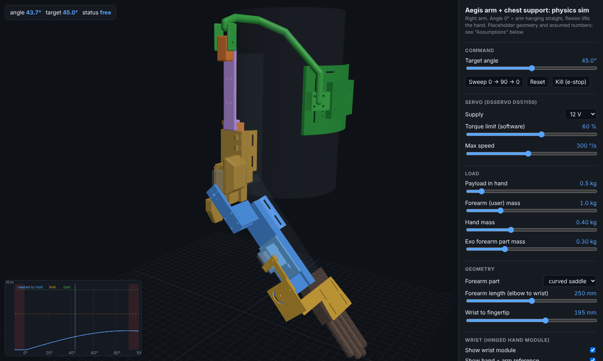
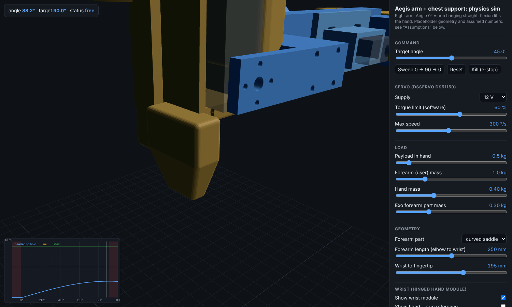

> **Note:** `test-files/` is the old v12 set. Current parts are in `cad/` (generator in `generator/`).

# Aegis Armor (Black Carapace + Aegis)

Hack Club **Fallen** submission by Adhrit Pradeep (Hack Club: adhrit2012).

A wearable system for the right arm: an **EMG sleeve** ("Black Carapace": steel-thread electrodes on a tight full-sleeved shirt, read by Upside Down Labs Muscle BioAmp Candy boards) driving a **servo elbow exoskeleton** ("Aegis": DS51150 servo at the elbow, optional wrist joint, chest support). Related to the Volition / NPG Lite project.

> **Status: early. Nothing here is a finished or tested design yet.**

I've been passionate about brain-computer and body-computer interfaces for a long time, and I'm a fan of Warhammer 40k, especially its tech. The Black Carapace, the interface space marines use to control their power armor, is the thing I've most wanted to build my own version of. It's a project I kept putting off, and Fallen gave me the push to start. This is my version: a tight full-sleeved shirt with steel-thread electrodes that reads my muscle signals (Black Carapace), driving a servo elbow exoskeleton for my right arm (Aegis).

## What it is and how to use it

- **Black Carapace** is a tight full-sleeved shirt with steel-thread electrodes. Muscle BioAmp Candy boards turn the muscle signal into a voltage the controller can read.
- **Aegis** is a one-arm servo exoskeleton: a DSSERVO DS51150 at the elbow (no wrist servo: it adds weight for little benefit), Velcro straps instead of rigid cuffs, mechanical end stops, and a chest support that links the arm to a chest plate.
- **To look at it:** open the interactive simulator (enable GitHub Pages, then visit `/sim/`). Drag the target angle, load the arm, change the supply voltage and torque limit, show or hide the wrist and the chest support, and press *Kill (e-stop)*.
- **Garment status:** the garment is not built yet. The plan (4 Candy boards on the chest plate, steel-thread electrode traces running through a tight shirt to the chest, tested on both a sleeve and a full shirt, with the noise to be characterised on the bench) is in `docs/garment.md`.
- **To read the parts:** `cad/` holds the 3D files, `docs/wiring.md` the wiring.

## Why I made it

I have a passion for brain-computer interfaces and I'm a fan of Warhammer 40k, to some extent. I always wanted a flexible interface suit that could assist me. I had the idea for a while, and when Fallen came up I decided to use the opportunity to at least design and implement it.

## Screenshots

### Full 3D assembly
Arm, chest support, an older wrist module (not part of the current build) and body reference in the simulator (placeholder geometry):

### PCB
No custom PCB in this build: the electronics are Upside Down Labs boards (Muscle BioAmp Candy x4) and a Seeed XIAO ESP32-S3 controller.

### Schematic / wiring diagram
Made in CircuitBench (concept diagram, stand-in parts, see `docs/wiring.md` for what each stand-in means):

### 3D render (optional)
Parts only, then the elbow at 90 degrees:

### Anything else
- Live simulator: `/sim/` (GitHub Pages)
- Wiring project file for CircuitBench: `docs/circuitbench/aegis-wiring.circuitbench.json`
- Generator script for all parts: `generator/make_aegis_v15.py`

## For the build submission

- Hardware demo (SG90 desk version of the elbow, 5 s): [`docs/media/sg90-desk-demo.mp4`](docs/media/sg90-desk-demo.mp4)

  

  What it shows: the printed elbow replica (0.4x mini test parts) being swung by an SG90 servo, driven from a small servo tester. What it is not: the full-size DS51150 arm, and nothing is worn or powered on a person. The EMG garment is not in this clip.
- Full demo video: TODO (link)
- Photos of the final product: TODO (add to `journal/` and link here)

## Repository layout

| Folder | What goes there |
|---|---|
| `firmware/` | Code for the servo controller (torque limit, current limit, kill switch). |
| `journal/` | Photos and notes that go with your Fallen journal entries. |
| `docs/` | Design notes, safety notes, measurements. |
| `cad/`, `generator/` | Full-size part files and the script that makes them. |
| `sim/` | Interactive physics simulation of the elbow (open `sim/index.html` through a web server, or enable GitHub Pages and visit `/sim/`). |
| `test-files/` | Placeholder STLs used only for testing in CircuitBench. See note below. |
| `bom.csv` | Bill of materials (provisional, see `docs/bom-notes.md`). |

## Safety

This device puts motor torque on a human arm. Required before any real use: a hardware kill switch (e-stop), physical end stops on every joint, a software torque limit and a current limit. See `docs/safety.md`.
