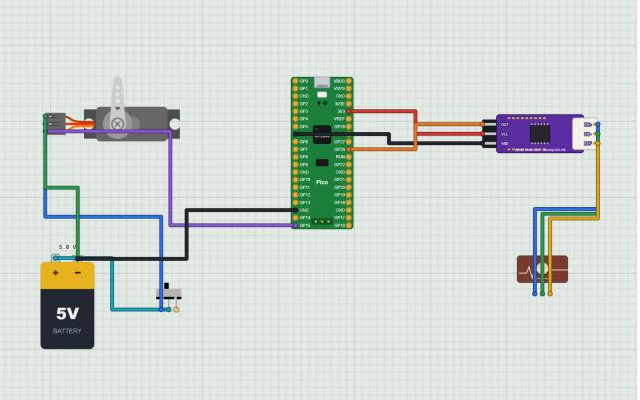

# Wiring (made in CircuitBench)

Project file: [`circuitbench/aegis-wiring.circuitbench.json`](circuitbench/aegis-wiring.circuitbench.json)
(open https://circuitbenchlab.onrender.com, then *File, Import project file*).

> **Newer diagram.** The picture and file above are the older Pico stand-in version. The current electronics design (XIAO ESP32-S3, 4 BioAmp pills, relay contactor with e-stop, 5 V rail) is in [`circuitbench/aegis-electronics.circuitbench.json`](circuitbench/aegis-electronics.circuitbench.json) (File, Import project file). CircuitBench does not have an exact library model for every planned component, so the diagram uses the closest available symbols: a generic battery for the 3S LiPo pack, a 7805 symbol for the LM2596 buck converter, a small relay for the 12 V relay, a generic servo for the DS51150, and pill symbols for the Muscle BioAmp Candy boards.

These substitutions represent the intended electrical functions and connections, rather than the exact physical components. Their default dimensions, ratings, terminals and behaviour should not be interpreted as specifications for the actual hardware. The BMS, fuse, INA226 and TVS are not modelled. Drawn in CircuitBench; not simulated.

It is a **concept diagram**, not a tested circuit.

## Connections

| From | To | Why |
|---|---|---|
| Electrodes E+ / E- / REF | BioAmp EXG Pill IN+ / IN- / REF | muscle signal in |
| Pill VCC / GND | Pico 3V3 / GND | 3.3 V supply, common ground |
| Pill OUT | Pico GP26 (A0, ADC) | EMG signal to the controller |
| Pico GP15 | Servo PWM | position command |
| Battery + | Slide switch (common) | the switch is the kill switch in the servo power line |
| Slide switch | Servo V+ | servo power only when the switch is on |
| Battery - | Servo GND and Pico GND | one common ground |

## What the stand-ins mean (CircuitBench has no exact part for these)

| Diagram component | Actual planned component | Explanation |
|---|---|---|
| Raspberry Pi Pico | Seeed XIAO ESP32-S3 | Represents the microcontroller. The older Pico pin labels are not XIAO pin assignments. |
| One BioAmp EXG Pill and signal source | Multiple Muscle BioAmp Candy boards | Simplifies the EMG input and electrode connections. |
| SG90-style servo | DSSERVO DS51150 | Represents a servo actuator, not the actual DS51150 dimensions, torque or supply requirements. |
| 5 V battery | 3S LiPo supply | Represents a power source, not the actual battery voltage or capacity. |
| Slide switch | Hardware emergency-stop button | Illustrates interruption of servo power, not the final e-stop implementation. |

Still to do before real use: servo power from its own supply (not from the controller), a fuse, a current limit, and the e-stop cutting servo power in hardware. See `safety.md`.
